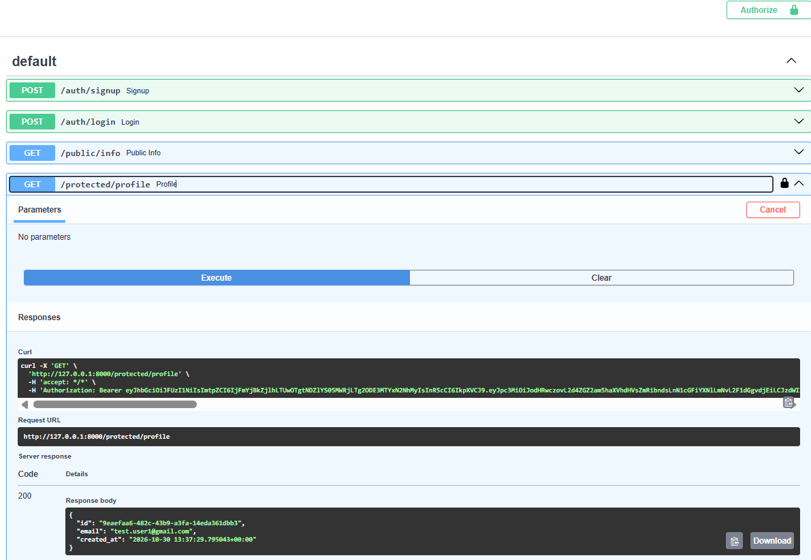

# Auth API: Login & Protect
A secure FastAPI backend that uses **Supabase Auth** for sign up, log in and log out, verifies JSON Web Tokens (JWTs), and protects private routes. It includes interactive Swagger UI docs with bearer authorization.
## Setup
1. Create a free project at [supabase.com](https://supabase.com). In **Authentication → Sign In / Providers → Email**, turn "Confirm email" off for practice.
2. Copy `.env.example` to `.env` and fill in your Project URL and anon (publishable) key from **Project Settings → API**:
   ```
   SUPABASE_URL=your_project_url
   SUPABASE_KEY=your_anon_key
   PORT=8000
   ```
3. Create a virtual environment and install dependencies:
   ```
   python -m venv .venv
   .\.venv\Scripts\python.exe -m pip install -r requirements.txt
   ```
## Run
```
.\.venv\Scripts\python.exe -m uvicorn main:app --port 8000
```
Swagger docs: http://localhost:8000/docs
## API reference
| Method | Route | Purpose | Auth needed |
|--------|-------|---------|-------------|
| POST | `/auth/signup` | Create a new account | No |
| POST | `/auth/login` | Log in and get a JWT | No |
| POST | `/auth/logout` | End the session | Yes (Bearer token) |
| GET | `/protected/profile` | Read private profile data | Yes (Bearer token) |
| GET | `/public/info` | Read public data | No |
| GET | `/protected/dashboard` | Second protected route (same guard) | Yes (Bearer token) |
Status codes: 201 signup, 200 login/read, 204 logout, 400 missing input, 401 missing/invalid/expired token.
## Swagger UI

